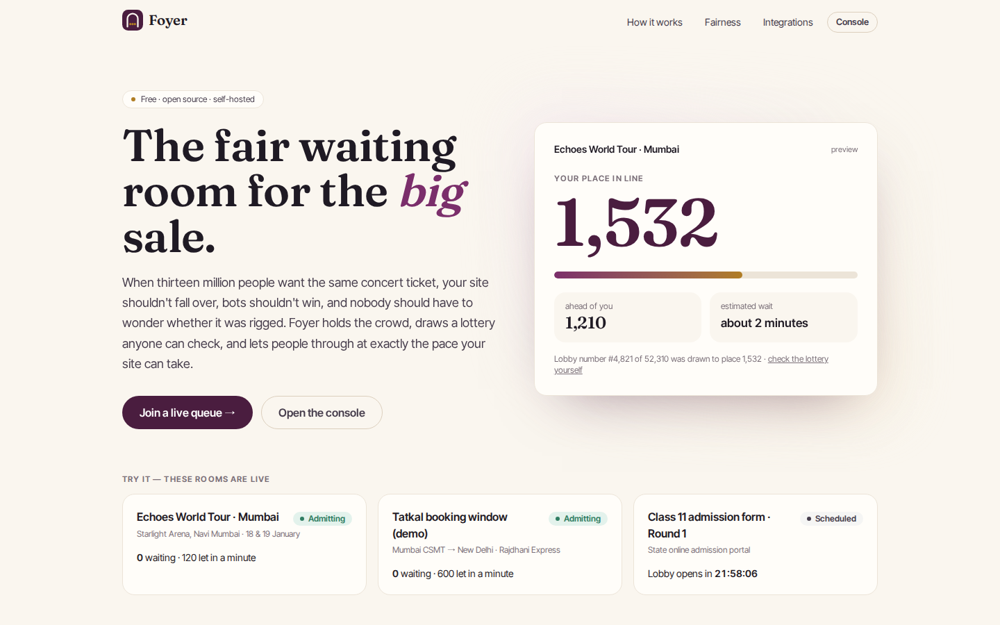
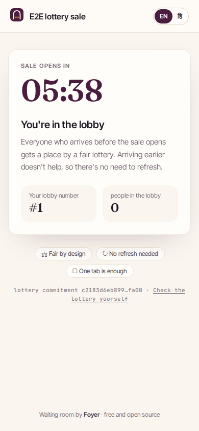
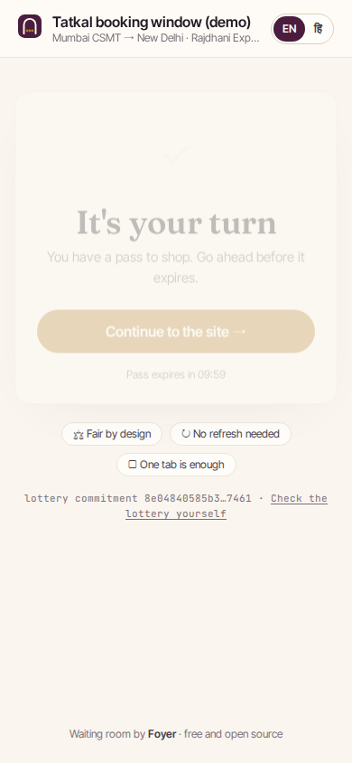
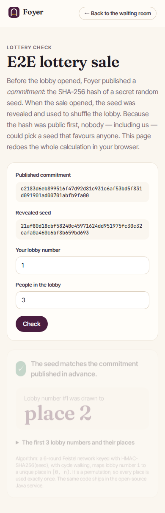
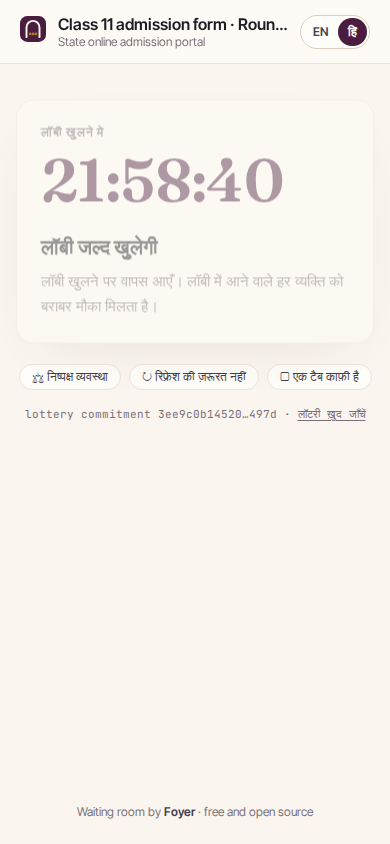
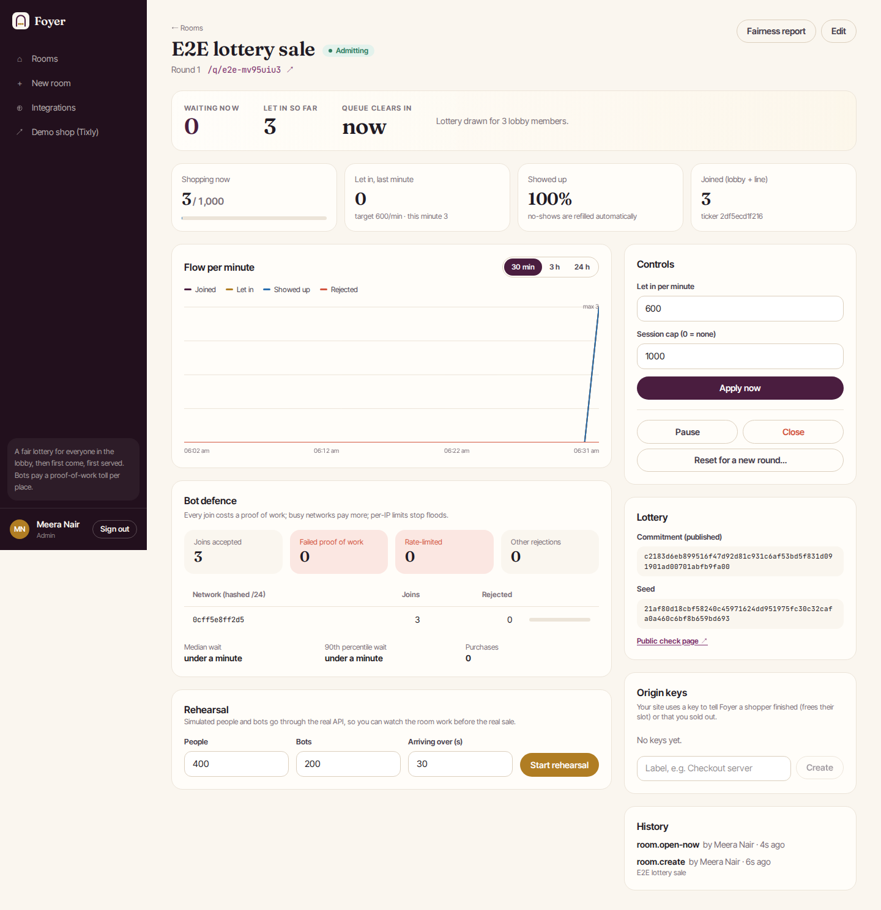

# Foyer

**A free, open-source virtual waiting room for flash sales. When millions of people arrive at once for concert tickets,
Tatkal trains or an admission form, Foyer holds the crowd, gives everyone who came early an equal chance through a lottery
anyone can check, makes bots pay for every place, and lets people through at exactly the pace your site can take.**

`Java 21` · `Spring Boot 4` · `WebFlux` · `Spring Cloud Gateway` · `Kafka` · `Redis 8 (Lua)` · `PostgreSQL` · `Ed25519` ·
`Angular 22` · `Web Workers` · `Docker` · `Kubernetes` · `KEDA`

> **Who is this page for?** Everyone. [The problem](#the-problem) and [What Foyer does](#what-foyer-does) explain the
> product; [Run it](#run-it) and [How to test it](#how-to-test-it) let you try it; [How it works](docs/HOW-IT-WORKS.md) is
> the full walkthrough; [Testing](docs/TESTING.md) has every result and the bugs testing found. Why this problem:
> [docs/RESEARCH.md](docs/RESEARCH.md).



---

## The problem

Whenever something scarce goes on sale at a fixed time, three things go wrong together:

- **The site falls over.** About 13 million people tried to buy Coldplay's Mumbai tickets on BookMyShow (2024); the site
  went down. Maharashtra's Class 11 admission portal crashed within an hour of opening (2025) with about 1.5 million
  students registering. Ticketmaster saw 3.5 billion requests for the Eras Tour presale.
- **Bots take the stock.** BookMyShow's CEO said roughly 10 million of the Coldplay attempts were bots. Indian Railways said
  more than half of Tatkal booking attempts were bots.
- **Nobody can tell whether it was fair.** A queue the public can't verify is a queue nobody trusts.

The commercial answer (Queue-it) is quote-only enterprise software; the free tiers that exist are tiny. Sources and figures:
[docs/RESEARCH.md](docs/RESEARCH.md).

## What Foyer does

| For | What they get |
|---|---|
| **People buying** (waiting room, `/q/<sale>`) | A calm page instead of a crashing one: a countdown in the lobby, then a place in line, people ahead, an honest wait estimate, and "it's your turn". No refreshing, one tab is enough, a reload keeps your place. English and Hindi, built for small phone screens. |
| **Anyone** (verify page) | The lottery seed's SHA-256 hash is published *before* the lobby opens. After opening, anyone can recompute their place in their own browser and check the seed matches. |
| **The site selling** (plugins) | Admitted visitors carry a short-lived **Ed25519-signed pass** that your site checks **offline** — a Spring Boot starter, an nginx `auth_request` block, a one-line JS tag, or a plain HTTP API for apps. Your servers only ever see the rate you chose. |
| **Organisers** (console) | Schedule a sale; watch the lobby fill and the line move second by second; change the rate or session cap mid-sale; pause, open early, close, reset for a new round; rehearse with simulated people and bots; read the fairness report afterwards. |

**How the fairness works, in one paragraph.** Everyone who arrives between the lobby opening and the sale opening gets a
*lobby number*. At opening, the lobby is frozen and shuffled with a keyed permutation (a Feistel network over HMAC-SHA256)
seeded by a value whose hash was published in advance. Arriving 30 minutes early or 1 millisecond before opening gives the
same chance; hammering the site at T-0 gives no advantage. People who arrive after opening join the back in order.

**How the bot toll works.** Joining costs a proof of work solved in a Web Worker (at the default 16 bits, about 65,000 hashes: a
fraction of a second on a phone; no CAPTCHA). Every place a bot farm takes costs it real CPU; networks that join suspiciously often
pay up to 64× more; per-IP limits stop floods; challenges are single-use and signed.

### Screens

| Screen | URL | What you see |
|---|---|---|
| Landing | `/` | The problem, how it works, the fairness proof, integrations, live demo rooms |
| Waiting room | `/q/:sale` | Browser check → lobby countdown → place in line → your turn → back to the site; sold out, paused, expired; EN / हिं |
| Lottery check | `/q/:sale/verify` | Commitment, revealed seed, your place recomputed in the browser, the first 20 draws |
| Rooms | `/console` | Every sale with its phase, countdown, rate and cap |
| Room | `/console/rooms/:id` | Live waiting / let in / shopping-now / showed-up, flow chart, bot defence, controls, rehearsal, lottery, origin keys, history |
| New / edit room | `/console/rooms/new` | Schedule presets, rate, cap, pass lifetime, bot toll slider with cost estimate, capacity planner |
| Fairness report | `/console/rooms/:id/fairness` | Seed vs commitment, rank correlation (early-bird advantage), average place per tenth of the lobby, rejections |
| Integrations | `/console/integrations` | Java, nginx, JS tag and HTTP API snippets filled in for the chosen room; the public key |
| Tixly demo shop | `http://localhost:3006` | A ticket shop protected by the `foyer-guard` filter |

| Lobby (390 px) | Your turn | Check the lottery | Hindi |
|---|---|---|---|
|  |  |  |  |



## Architecture

```
 Visitors ──► nginx / CDN ──► Angular waiting room ──► edge-gateway ──► queue-service ×N (WebFlux)
                                                       (per-IP limits)      │ join · status · passes · verify · origin callbacks
 Your site ── foyer-guard (offline Ed25519 check) / nginx auth_request ─────┘ admission ticker (one Redis lease per room)
                                                                            │
 Organisers ──► console ──► edge-gateway (JWT) ──► room-service ── outbox ──► Kafka foyer.rooms (compacted) ──► every queue-service
                                                └► insight-service ◄── Kafka foyer.events (12 partitions) ◄── queue-service
 Redis: tickets counters, frontier, sessions, leases, used challenges, rate limits      Postgres: rooms (room-service), stats (insight)
```

| Module | Responsibility |
|---|---|
| `foyer-core` | Plain Java, no dependencies: the lottery permutation and commit-reveal, proof of work, Ed25519 passes, HMAC tickets, the admission step. Shared by the services and the plugin. |
| `contracts` | Room snapshots and queue events (Kafka topics) |
| `queue-service` | The hot path: challenge, join, status, passes, pass verification, origin callbacks, admission ticker. Stateless apart from Redis; scales out. |
| `room-service` | Organisers, rooms, schedules, seeds, origin keys, audit log, outbox; rehearsal simulator; demo data |
| `insight-service` | Consumes every queue event into Postgres: per-minute flow, wait times, networks, fairness report |
| `edge-gateway` | Spring Cloud Gateway: console JWT and roles, per-IP Redis rate limits for visitors |
| `foyer-guard` | The origin plugin: servlet filter + Spring Boot auto-configuration |
| `demo-shop` | Tixly, a protected ticket shop for the demo |
| `frontend` | Angular 22 + Tailwind v4: landing, waiting room (PoW in a Web Worker), verify page, console |

### The life of one visitor

1. They open a protected page on the shop. `foyer-guard` finds no pass and redirects to `/q/echoes-mumbai?return=…`.
2. The waiting room asks for a challenge, solves it in a Web Worker and joins. Redis assigns a lobby number (before opening)
   or a queue number (after) in one Lua script that also enforces the per-IP limit. The ticket is HMAC-signed and kept in
   `localStorage`, so a reload or second tab keeps the place.
3. The page polls at the interval the server suggests: rarely when far back, every few seconds near the front.
4. Each second, the queue-service holding the room's lease advances the **frontier** by `rate / 60` (respecting the session
   cap). Anyone whose place is below the frontier is admitted. A poll is a single Redis `MGET`, whatever the crowd size.
5. On their next poll, the visitor receives an Ed25519 pass and is sent back to the page they came from (same origin only).
6. The guard verifies the pass offline, moves it into an `HttpOnly` cookie, and the visitor shops. When they pay, the shop
   tells Foyer (`/api/origin/complete`), which frees the slot for the next person.

More: [docs/HOW-IT-WORKS.md](docs/HOW-IT-WORKS.md).

## Engineering decisions (and why)

- **A frontier counter, not a sorted set.** Position is arithmetic (`place − served`), so status polls are O(1) and the
  queue never needs to be scanned or rewritten.
- **A permutation, not a shuffle.** The lottery is never materialised: each place is computed on demand from the lobby
  number, the lobby size and the seed. A 10-million-person lobby costs nothing extra.
- **Commit-reveal.** The organiser can't choose the seed after seeing who joined; anyone can check.
- **Passes verified offline.** Your site never calls Foyer per request, so Foyer can't become your bottleneck or your
  single point of failure.
- **Kafka is never on the visitor's path.** Events are published asynchronously with a bounded retry buffer; if Kafka is
  down, the sale doesn't notice (proved in the chaos test).
- **One admission leader per room** via a 4-second Redis lease; a killed instance's rooms move to another in seconds.
- **Ticks catch up.** The ticker admits by elapsed time (capped at 15 s), reads its inputs in parallel and only commits its
  clock after admitting, so slow ticks under load don't lose admissions.

## Measured results

All on one laptop (Docker Desktop with 4 GiB for everything, k6 on the same machine). Details: [docs/TESTING.md](docs/TESTING.md).

| What | Result |
|---|---|
| One queue-service, 100 joins/s + 1,000 status polls/s for 60 s (warm) | 0 errors in 72,600 requests; status p50 1.4 ms, p95 3.4–4.2 ms, p99 ≈ 11 ms; join (challenge + join) p95 ≈ 9–11 ms |
| Admission accuracy under that load | 1,254–1,259 admitted vs 1,200/min target over ~63 s |
| Saturation (200 joins/s + 2,000 polls/s) | ≈ 2,100 req/s per instance, still 0 errors; tails grow (status p95 560 ms) → scale out; admission rate still held |
| Failover | Admission leader killed → lease taken by the other instance in 4 s; admission continued |
| Lottery | Bijection for every size 1…2,000 and random large sizes; chi-square and Spearman tests for uniformity; browser and Java produce identical places |

## Run it

Needs Docker (4 GiB is enough).

```bash
docker compose up -d --build --wait     # about 3 minutes the first time
```

| Open | |
|---|---|
| http://localhost:3005 | Landing page, then **Join a live queue** |
| http://localhost:3006 | Tixly demo shop — open an event and you'll be sent through the waiting room |
| http://localhost:3005/login | Console: `admin@foyer.test` / `foyer-admin` (admin) or `ops@foyer.test` / `foyer-viewer` (read-only) |

Demo rooms: **Echoes World Tour · Mumbai** (lobby open on start-up, sale opens 10 minutes later — join in time and you'll
be in the lottery), **Tatkal booking window** (open now), **Class 11 admission form** (tomorrow 10:00 IST). In the console,
open a room and start a **rehearsal** to watch simulated people and bots go through.

Ports: 3005 UI, 3006 demo shop, 8086 gateway, 8087 queue-service (direct, for load tests). Stop with `docker compose stop`.

### Develop locally

```bash
./mvnw verify                          # 36 Java tests incl. Testcontainers (Postgres, Kafka, Redis)
cd frontend && npm ci && npx ng test --watch=false && npx ng serve   # proxy to the gateway on :8086
```

### Kubernetes

```bash
kubectl apply -k k8s/          # Postgres, Redis (AOF on a volume), Kafka, the services with HPAs, PDBs, NetworkPolicies, Ingress
kubectl apply -k k8s/keda      # + KEDA: pre-scale queue-service before a sale (cron) and scale insight on Kafka lag
```

Set your images in `k8s/base/kustomization.yaml` and real secrets in `k8s/base/config.yaml` (see the comments there).

### Use it on your own site

Create a room in the console, then follow **Integrations** — the snippets are filled in for your room:

```yaml
# Spring Boot: add dev.foyer:foyer-guard, then
foyer:
  guard:
    enabled: true
    room-id: rm_…
    waiting-room-url: https://foyer.example.com/q/your-sale
    foyer-url: https://foyer.example.com
    protected-paths: [/events/**]
```

```html
<!-- any page: soft protection -->
<script src="https://foyer.example.com/foyer.js" data-room="your-sale" data-room-id="rm_…"></script>
```

## How to test it

| Suite | Command | Result |
|---|---|---|
| Java unit + integration | `./mvnw verify` | 36 tests, 0 failures |
| Frontend unit | `cd frontend && npx ng test --watch=false` | 16 tests |
| API smoke (full flow, security checks) | `./scripts/smoke-test.sh` | 59 / 59 |
| Real browser (Chromium via Playwright) | `./scripts/browser-e2e.sh` | 17 / 17, screenshots in `e2e/screenshots` |
| Chaos (Kafka, insight, room-service down; Redis restart; leader killed) | `./scripts/chaos-test.sh` | 22 / 22 |
| Session cap with bots | `./scripts/rehearsal-cap-check.sh` | peak 24 shopping vs cap 25 |
| Load (k6) | `./scripts/load-test.sh` | see above |
| Kubernetes manifests | `./scripts/k8s-validate.sh` | 35 / 35 valid in each overlay |

Test plan: [docs/TEST-PLAN.md](docs/TEST-PLAN.md). Results and the bugs found: [docs/TESTING.md](docs/TESTING.md).

## API

| Endpoint | Who | What |
|---|---|---|
| `GET /api/q/{sale}` | anyone | Phase, schedule, rate, lottery commitment (seed once open); cacheable 1 s |
| `POST /api/q/{sale}/challenge` | visitor | A signed proof-of-work challenge |
| `POST /api/q/{sale}/join` | visitor | `{challenge, nonce}` → ticket (lobby or queue) |
| `GET /api/q/{sale}/status` | visitor (`X-Foyer-Ticket`) | Place, people ahead, ETA, next poll; or the pass |
| `GET /api/public/rooms/{sale}/epochs` | anyone | Every round's commitment, and its seed once opened |
| `GET /.well-known/foyer-keys` | sites | The Ed25519 public key |
| `GET /api/passes/verify?room=` | sites (nginx) | 200 if the pass is valid, unused and for this room |
| `POST /api/origin/complete`, `/sold-out` | sites (`X-Foyer-Origin-Key`) | End a session; announce sell-out |
| `/api/console/**` | organisers (JWT) | Rooms, controls, live numbers, insight, rehearsals, origin keys |

## Project layout

```
foyer-core/          lottery, proof of work, passes, tickets, admission step (+ statistical tests)
contracts/           Kafka topics, room snapshot, queue event
services/
  room-service/      rooms, seeds, origin keys, outbox, rehearsal simulator
  queue-service/     visitor API, Redis Lua scripts, admission ticker, passes
  insight-service/   event store, flow, waits, fairness
  edge-gateway/      JWT, roles, rate limits
foyer-guard/         the Spring Boot / servlet plugin
demo-shop/           Tixly, the protected demo shop
frontend/            Angular app + public/foyer.js tag
k8s/                 base + keda overlay
scripts/             smoke, browser e2e, chaos, cap check, load (k6), k8s validation, pow.py
e2e/                 Playwright suite and screenshots
docs/                research, plan, test plan, how it works, testing
```

## Honest limitations

- **Bots that pay the toll still get places.** Proof of work makes each place expensive, not impossible; a determined farm
  with real CPUs can still join (the rehearsal shows how many). It's a cost lever, alongside per-IP and per-subnet limits —
  pair it with identity checks at checkout if the stakes demand it.
- **The JS tag is soft protection.** Browser code can be bypassed; protect checkout with the Java filter, nginx or the
  verify API. The offline Java guard can't know a pass was already used for a purchase, so the shop must enforce one
  purchase per pass (the demo does; `/api/passes/verify` also refuses spent passes).
- **The session cap can briefly overshoot.** Admitted people who haven't come back count against the cap for 40 seconds;
  someone in a long-hidden browser tab (Chrome throttles timers to once a minute) may claim later, adding a few over the cap.
- **Cold starts.** A freshly started queue-service has much worse latency tails for its first minute (JIT warm-up). Scale up
  *before* a sale — the KEDA overlay does this on a schedule.
- **Rehearsal status lives in the room-service pod that runs it**, so the Kubernetes manifests run one room-service replica
  (sales continue without it).
- **Demo secrets** are in `docker-compose.yml` and `k8s/base/config.yaml`; replace them for anything real.
- Reddit couldn't be read from the build environment, so the research used news coverage and official statements instead.
